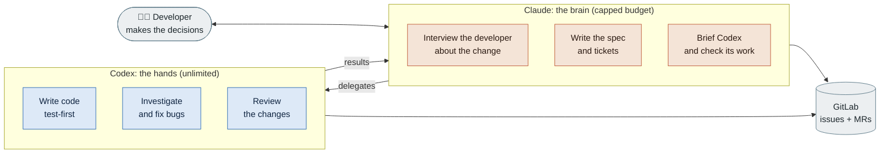
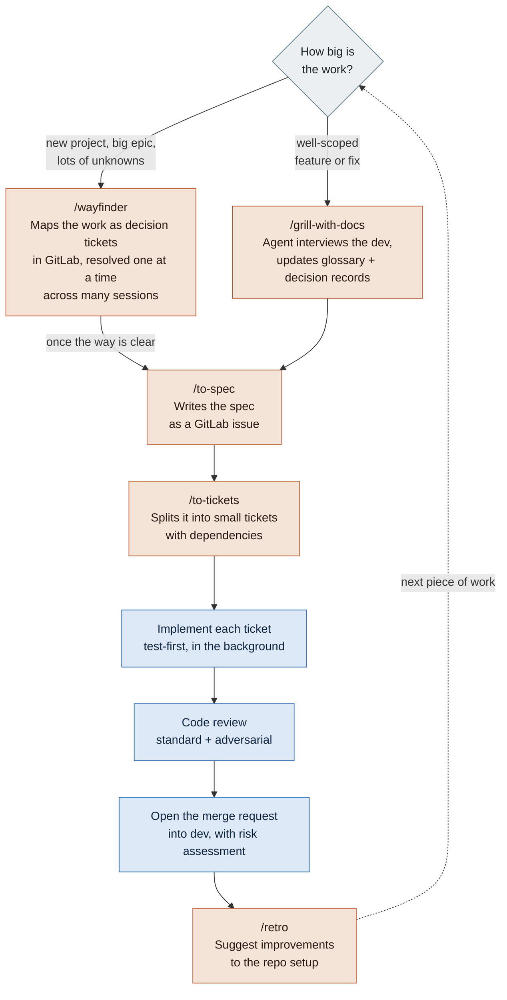
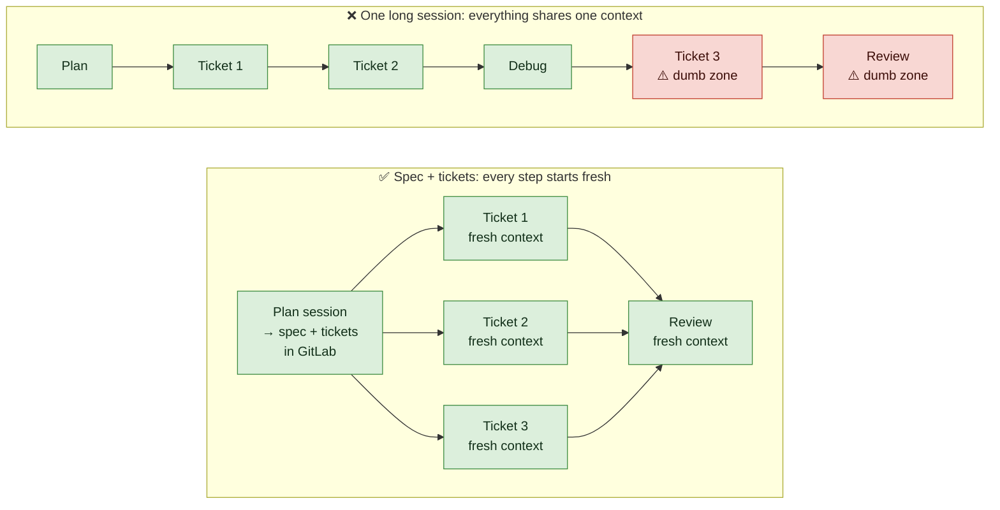
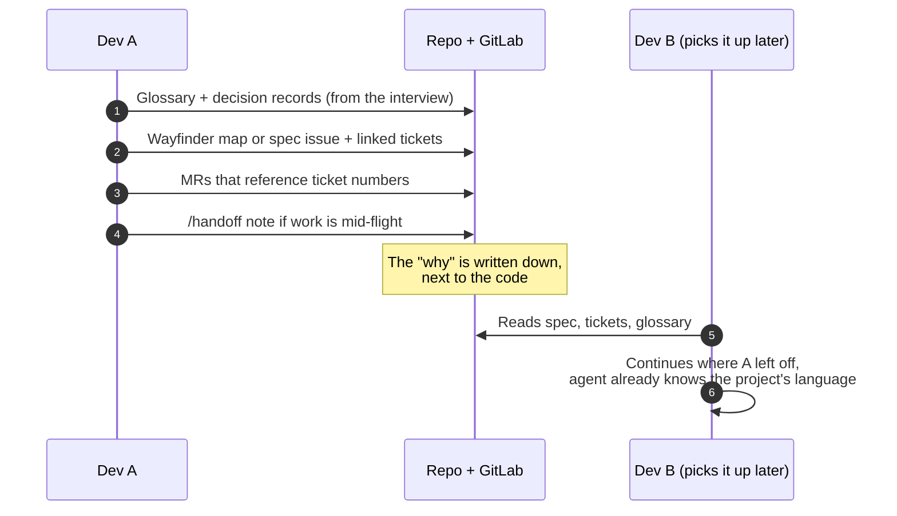
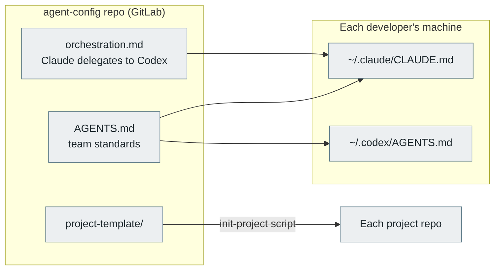
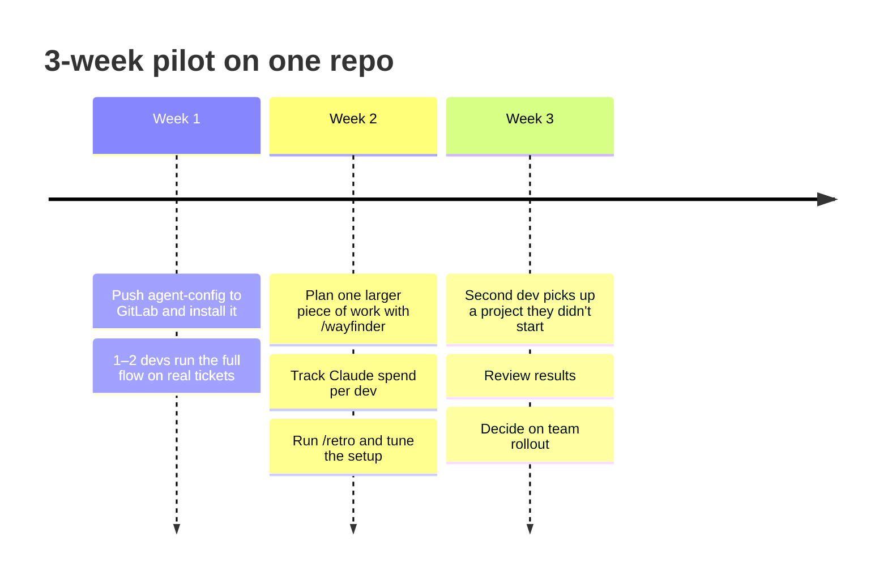

# Proposal: A Shared AI Coding Workflow for the Team

> **TL;DR:** Adopt one shared workflow built on Matt Pocock's open-source agent skills. Claude does the thinking (planning, specs, tickets, checking work) and Codex does the heavy lifting (writing code, tests, reviews). Breaking work into specs and small tickets keeps every agent session in its "smart zone," before quality drops off in long sessions. This gets more out of our capped Claude budget, uses the unlimited OpenAI access we already have, and makes every project easy for another teammate to pick up. The ask is a **3-week pilot on one repo**.

---

## The problem

Today, each of us uses AI coding tools in our own way. That causes four problems:

| Problem | What it looks like |
|---|---|
| **Budget pressure** | Claude is capped per developer ($200–$800/month). Using it for everything, including routine code generation, burns through the cap. Meanwhile our unlimited OpenAI access goes mostly unused. |
| **Inconsistent quality** | Agents left to guess write plausible code that slowly degrades the codebase. Long sessions make it worse: the agent gets sloppier the more it has in its context. Results depend on how each person prompts. |
| **Hard handoffs** | Plans and decisions live in personal chat histories or a local `TODO.md`. When someone picks up a teammate's project, the "why" behind the code is gone. |
| **Standards drift** | Our global `CLAUDE.md` lives on a shared drive, and everyone copies it to their machine by hand. Copies fall out of date, and Codex can't read `CLAUDE.md` at all. |

---

## The idea in one picture

Split the work by **what each model is best at, and what each one costs us.**

Claude handles the **high-judgment, low-volume** work, where its quality matters most. Codex handles the **high-volume** work (generating code, running tests, reviewing diffs), which is where most tokens get spent. A plugin from OpenAI ([codex-plugin-cc](https://github.com/openai/codex-plugin-cc)) lets Claude hand tasks to Codex without leaving the session.

---

## The process: Matt Pocock's skills

[Matt Pocock](https://www.aihero.dev/skills) is a well-known TypeScript educator who publishes the skills he uses daily as a free, MIT-licensed repo ([mattpocock/skills](https://github.com/mattpocock/skills), ~294k GitHub stars). A **skill** is a short instruction file that teaches an agent one good engineering habit, like grilling a plan or reviewing a diff, so it follows the same trusted process every time.

His core argument: an agent is only as good as the process it follows. The skills apply familiar engineering fundamentals to AI work:

- **Align before building.** The agent interviews you until every decision is made, instead of guessing.
- **Shared vocabulary.** A project glossary keeps naming consistent and makes agent output shorter and clearer.
- **Small steps with fast feedback.** Test-driven development in thin slices, so the agent always knows whether its code works.
- **Care about design.** Regular architecture reviews keep agent speed from turning the codebase into a ball of mud.

Because skills are plain text files, they work in both Claude Code and Codex. There's no platform lock-in.

### The main flow, with who does what

🟧 Claude &nbsp;&nbsp; 🟦 Codex

**Two ways in, depending on size:**

- **`/wayfinder`** for work too big or too fuzzy for one session, like a new project or a large epic. It lays out the work as a map of decision tickets in GitLab and works through them one at a time, pulling in research and prototypes where needed. When the way is clear, it produces the specs and tickets. This replaces the `TODO.md` build plan our current `CLAUDE.md` asks for, and the plan lives in GitLab where anyone can see and pick it up.
- **`/grill-with-docs`** for a well-scoped feature or fix. The agent interviews you until every decision is made, then the conversation becomes a spec and tickets.

Small edits and quick fixes skip the process entirely.

The developer stays in control at every step. They answer the interview, approve the spec, and merge the MR. Matt's point is that the developer's main job becomes making decisions and steering, not typing every line.

---

## Why specs and tickets: staying in the smart zone

The flow above can look like extra ceremony. Its real purpose is to work around the biggest practical limit of coding agents.

An agent is sharpest early in a session, while its context is small. Matt calls this the **smart zone**. As the session fills up with conversation, file contents, and tool output, the agent gradually gets sloppier: it forgets instructions, loses track of decisions, and makes more mistakes. That's the **dumb zone**. On today's frontier models it commonly starts somewhere around **125–150K tokens**, often well before the context window is technically full. There's no error message when you cross into it, so it's easy to miss.

The usual way to use an agent, one long session that plans, codes, debugs, and reviews, drifts straight into it:

🟩 smart zone &nbsp;&nbsp; 🟥 dumb zone

That's why each part of the workflow exists:

- **The spec and tickets are the handoff.** Planning happens in one session. The result is written down in GitLab, so each later session starts with exactly what it needs instead of the whole conversation.
- **Each ticket is sized to fit in one smart zone.** One agent, one ticket, one fresh session, finished before quality drops.
- **Every Codex task is a fresh session by design.** Delegating to Codex doesn't just save Claude budget. It also means each implementation and each review starts clean, and Claude's own session stays small because it never fills up with code.
- **`/wayfinder` handles work too big to even plan in one session.** It spreads the planning across many sessions, with the decisions recorded in GitLab between them.
- **`/handoff` covers the rest.** When a session gets long anyway, the agent writes a summary for a fresh session to continue from.

It also saves money: every turn re-reads the whole context, so a bloated session costs more per message *and* produces worse work.

---

## Why this works for a team, not just one person

Every artifact the workflow produces lives **in the repo or in GitLab**, not in someone's chat history.

What a teammate finds in every project:

| File / place | What it gives them |
|---|---|
| `AGENTS.md` | How to build, test, and run the project, plus an architecture map. Read by both Claude and Codex. |
| `GLOSSARY.md` | The project's terms, so people and agents use the same words |
| `docs/adr/` | Records of hard-to-reverse decisions and why they were made |
| GitLab issues | The plan (a wayfinder map or a spec) and every ticket, with blocking relationships |

---

## How we'd roll it out

I've already built a small **`agent-config`** repo that makes setup a two-command job.

- **One source of truth.** Our existing global `CLAUDE.md` standards (architecture, C#/.NET, logging, database, testing, security, branching) are already moved into a shared `AGENTS.md` that both agents read. No more copying from the shared drive: changing the standards is a merge request, and getting them is `git pull`.
- **Existing projects come along.** A project with its own `CLAUDE.md` gets that content moved into `AGENTS.md` automatically, so Codex can read it too.
- **Budget-safe by default.** The delegation rules are written for the smallest Claude budget on the team, so the workflow is identical for everyone.
- **Codex is optional.** Each developer chooses who does the heavy lifting: Codex, or Claude subagents. They can switch any time or override it for a single task. The process and its outputs (tickets, commits, reviews, MRs) are the same either way, so handoffs don't depend on anyone's choice.
- **Low-risk.** It's a handful of text files and two setup scripts (PowerShell for Windows). Nothing changes in CI, GitLab settings, our branching flow, or existing code.

### Proposed pilot

**What we'd measure:**

1. **Claude spend per developer.** Does the workflow fit within the $200 tier?
2. **Handoff test.** Can a second developer pick up a pilot project without a walkthrough from the first?
3. **Quality signals.** Review comments per MR and bugs found after merge, compared with recent work.
4. **Developer experience.** A quick gut check from the pilot devs: faster, slower, or about the same?

---

## Risks and how we'd handle them

| Risk | Mitigation |
|---|---|
| Claude doesn't always delegate to Codex | Start with a written rule; if it leaks, add small team-specific versions of the skills that force delegation |
| Codex output quality is lower on some tasks | Every change still goes through tests and review; Claude can take over after two failed Codex attempts, and a developer can send any single task to Claude instead |
| Some developers don't want to use Codex | A per-developer "Claude mode" runs the same workflow with Claude subagents, on a smaller model where possible to stretch the budget. One setting, switchable any time. |
| Process feels heavy for small changes | Small edits skip the full flow; the skills are designed to be used à la carte |
| Upstream skills change under us | The plugin auto-updates; if a change hurts us, we pin a version or fork the specific skill |
| Code leaves our environment | No change from today: we already have access to both Claude and OpenAI models, and the workflow uses the same tools |

---

## The ask

1. **Approve a 3-week pilot** on one repo with one or two developers.
2. **Keep current Claude limits** during the pilot so we get real spend data. After that, we come back with a concrete per-developer number instead of a range.
3. **Set aside 30 minutes** at the end of week 3 to review results and decide on a team rollout.

---

## Watch Matt explain it

If you'd rather hear it from the source, these are the best places to start:

| Video | Length | Why watch it |
|---|---|---|
| [**mattpocock/skills: A complete AI Coding workflow, end-to-end**](https://www.youtube.com/watch?v=M6mYodf0dJM)  Matt Pocock, July 2026 | ~17 min | **Start here.** The whole flow in one video: setup, the grilling interview (8:31), specs and tickets (10:08), and implementation plus review (13:51). |
| [**/handoff is my new favourite skill**](https://www.youtube.com/watch?v=dtAJ2dOd3ko)  Matt Pocock, May 2026 | ~12 min | How context windows fill up (the problem behind the smart zone) and how handing off to a fresh session differs from `/compact`. Also covers how work moves between sessions and between agents, which matters for team handoffs and for splitting work between Claude and Codex. |
| [**/wayfinder: Nothing is too big to plan anymore**](https://www.youtube.com/watch?v=F3lL98Pj90o)  Matt Pocock, July 2026 | 15 min | The skill we'd use to kick off new projects and large epics. Shows how it maps work as decision tickets in the issue tracker (4:30), how tickets block each other (7:40), and how specs and tickets come out of the map (9:44). |
| [**Ship like the best engineers: Matt Pocock's AI workflow**](https://www.youtube.com/watch?v=Q3uuE2adUT8)  The Hype Kevin (third-party), Oct 2026 | — | An outside walkthrough of the latest version (v1.3). Follows one small feature through every step, then a real 10-ticket run. Also answers "isn't this just waterfall?" |

**Written docs:**

- [AI Skills for Real Engineers](https://www.aihero.dev/skills) is Matt's own guide. It lays out the main flow, groups all the skills by purpose, and explains why they compound: each skill's output is the next one's input.
- [Smart zone](https://www.aihero.dev/ai-coding-dictionary/smart-zone), from Matt's AI coding dictionary, is a short read on the smart zone and dumb zone and how to keep each task inside one.

---

## Sources

- Matt Pocock, [AI Skills for Real Engineers](https://www.aihero.dev/skills) (aihero.dev)
- Matt Pocock, [Smart zone](https://www.aihero.dev/ai-coding-dictionary/smart-zone) (AI Hero AI coding dictionary)
- Matt Pocock, [mattpocock/skills](https://github.com/mattpocock/skills) (GitHub)
- OpenAI, [codex-plugin-cc](https://github.com/openai/codex-plugin-cc) (GitHub)
- Videos linked in the table above
